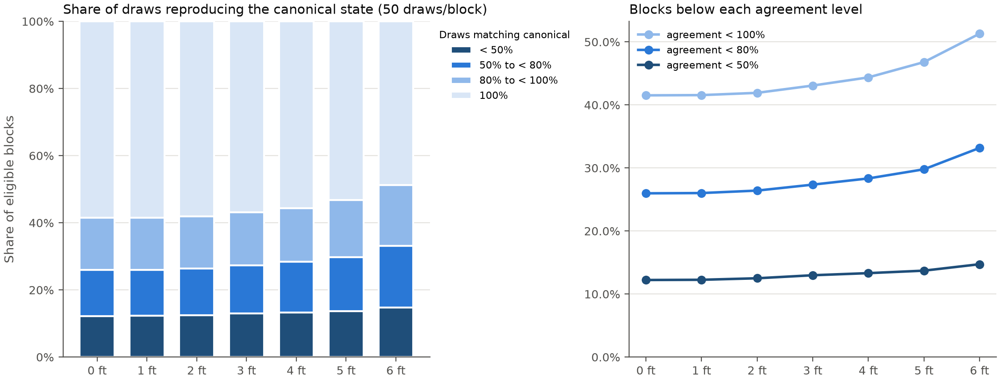
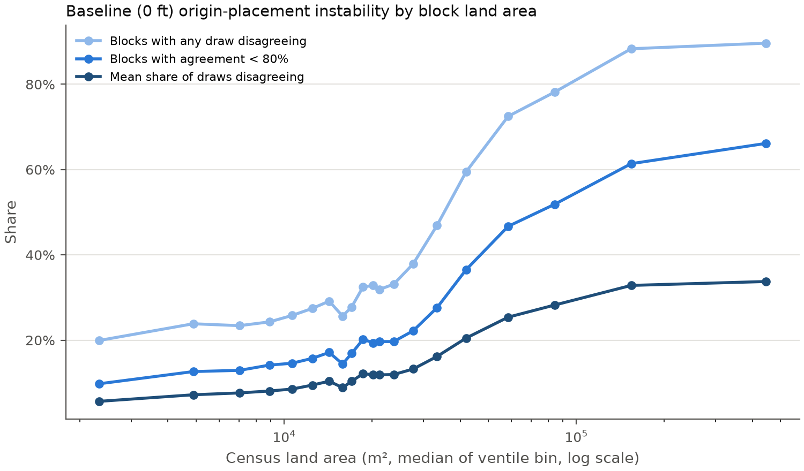
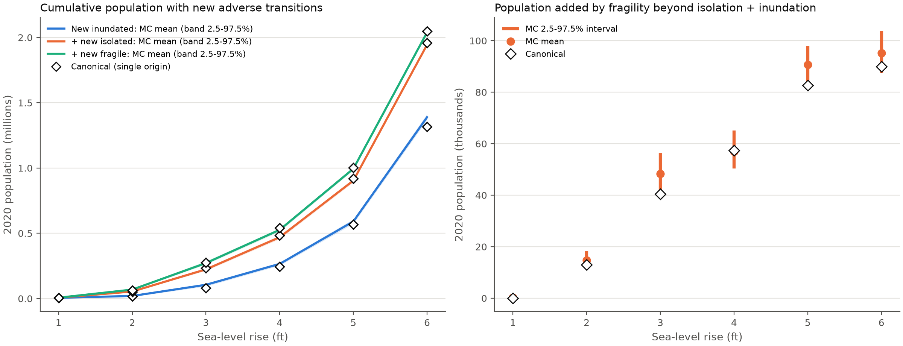
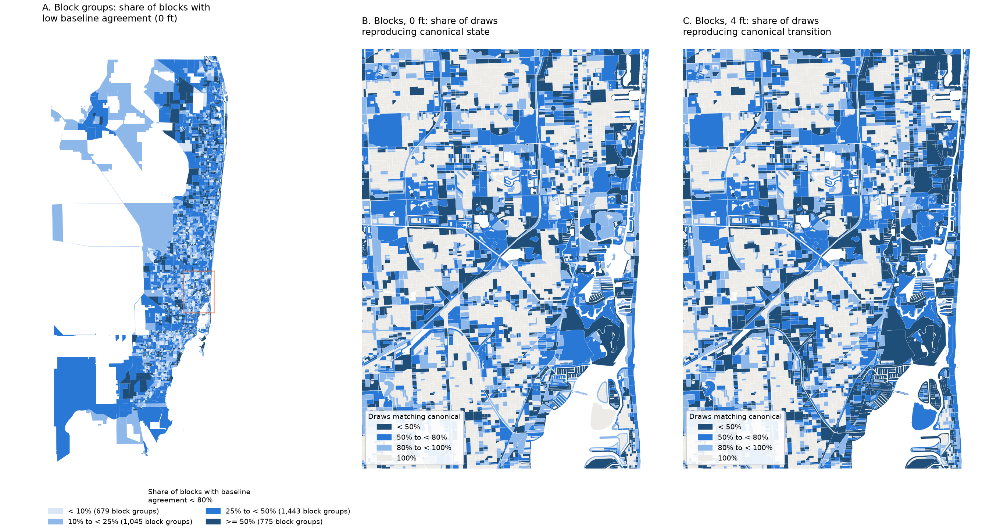

# Origin-placement sensitivity: Monte Carlo randomization of within-block origins

*Exploratory measurement-validity analysis for "Access Loss Under Sea-Level Rise". It does not modify
the manuscript analysis. Run date 2026-10-09; canonical reference `positive_layer_20260814_approach`.*

Every number below comes from files in this directory. Figures and tables are linked where they are
used. The scripts are in `scripts/origin_placement_sensitivity/`; the run order is in
[run_all.sh](../../scripts/origin_placement_sensitivity/run_all.sh) and provenance is in
[run_manifest.json](run_manifest.json).

## Executive summary

**What was randomized.** For each of the 68,521 analysis-eligible Census blocks, 50 origin points were drawn
uniformly at random inside the block's land polygon (the 2020 TIGER block polygon minus 2020 TIGER
AREAWATER). That gives 3,426,050 points. Each point was snapped and classified exactly as the canonical
representative point is. The same point is used at 0 ft and at every positive SLR scenario, so every
transition is a within-point comparison.

**What stayed fixed.** The road graph, the `approach` bridge rule, the facility locations and their
attachment, the NOAA extents, the LCC-only origin snap with its 2 km threshold, the classification rules
and their precedence, the eligible universe, and each block's 2020 population.

**What it measures.** How often a block's canonical classification is reproduced when its origin is moved
elsewhere in the block, and how much regional totals and social-vulnerability associations move as a
result. It measures sensitivity to origin placement. It does not measure accuracy: random land points are
not residences.

**Results in brief.**

1. **The engine reproduces the canonical analysis exactly.** All 494,865 canonical block-scenario states
   are reproduced. So is the unmodified production classifier on 690,900 pilot draw-scenarios, and on all
   1,612,693 LCC nodes in each of the 7 scenarios. Mismatches: 0.
2. **Individual block classifications are sensitive.** This is driven by the fragile/redundant
   distinction. At 0 ft:
   - 41.5% of blocks have at least one of 50 draws that disagrees with the canonical state.
   - The mean share of draws that agree is 85.3% (75.3% when weighted by population).
   - For blocks the canonical run calls *fragile*, only 59.8% of draws reproduce "fragile". For 7,670 of
     these 17,335 blocks (44%), the most common randomized state is *redundant*.
3. **The representative point systematically overstates baseline fragility.** This is a bias, not noise.

   | Baseline (0 ft) | Canonical | MC mean (2.5–97.5%) |
   |---|---|---|
   | Fragile share of blocks | 25.30% | 19.46% (19.27–19.64%) |
   | Population in fragile blocks | 2.38M | 1.83M (1.79–1.87M), −23% |

   The cause is mechanical. The representative point sits deep inside the block, where the nearest road
   node is more often on a dead-end part of the network. Uniform points fall more often near the
   bounding streets. Reweighting the draws to the canonical point's depth distribution reproduces the
   canonical rate (26.0% predicted vs 25.4% observed).
4. **Regional totals of the composite outcome are very stable. Its components are not.**
   - The number of blocks with a new fragile-or-worse transition falls inside the Monte Carlo interval at
     every SLR level. At 6 ft it is 20,716 canonical vs 20,722 MC mean.
   - The corresponding population is within ±3% at 3–6 ft.
   - The components shift in offsetting directions. Transitions out of baseline-fragile fall (fragile →
     isolated population −27% at 4 ft). Redundant → inundated rises (+29% at 4 ft). New inundation
     rises (+9% at 4 ft).
5. **Social-vulnerability associations keep their direction and ordering.**
   - The Black, Hispanic, renter and age-65+ AMEs keep the canonical sign in 50 of 50 replications, for
     all 7 transitions.
   - The ordering of the six indicators is essentially unchanged (minimum Spearman correlation 0.94).
   - Magnitudes shift by up to about ±19% (median 4%). For 10 of these 28 AMEs the canonical value lies
     outside the Monte Carlo interval.

**Substantive importance.** The quantity that depends most on origin placement is the *level of baseline
fragility*, together with everything conditioned on it: the fragile risk set and the fragile → X
transitions. Conclusions based on regional totals of new adverse transitions, and on the direction of the
social-vulnerability associations, are much less sensitive. The analysis does not show that one origin
rule is correct.

## Methods

### Engine and reuse of canonical artifacts

I read `scripts/02_access_flags.py` in full. With the canonical (non-legacy) settings, production
`scenario_results_for_origins` classifies an origin in three steps, in this order:

1. *inundated* if the point intersects the scenario's NOAA union (this takes precedence over everything);
2. otherwise *unclassified* if its LCC snap exceeds 2 km;
3. otherwise a state that depends only on the snapped node's position in that scenario's dry graph:
   - not in the dry graph, or in a dry component with no service → *isolated*;
   - degree 1, or no service in its 2-edge-connected component → *fragile*;
   - otherwise → *redundant*.

The nearest-service Dijkstra result feeds only the distance and detour columns, plus the legacy
collocated rule, which is off in the canonical run. Classification is therefore a function of (point
inundation, snap validity, node, scenario).

I computed one node-state table per scenario with the production helpers (`build_component_maps`,
`build_two_edge_component_maps`, `capped_local_edge_connectivity`) and reused it for every origin. I did
not use a shortcut based only on node degree or component size. Each dry graph was rebuilt with the
production functions, using the verified graph caches and scenario unions from the attachment experiment
(listed in `run_manifest.json`). Nothing canonical was overwritten.

### Sampling

- **Sampling area.** Points are drawn from the land polygon, in EPSG:32617. The constructed land areas
  match ALAND20: the median ratio is 0.9993 (UTM scale distortion), and 6 of 68,521 blocks fall below
  0.98.
- **Draw procedure.** Rejection sampling inside the polygon's bounding box, with an explicit
  `contains_xy` membership test (acceptance rate 18.1%).
- **Seeds.** Each block has its own generator, `default_rng([20261009, GEOID])`. Draws are nested: a
  10-draw run reproduces the first 10 of 50 exactly (checked on 200 blocks).
- **Canonical point.** The canonical representative point is kept separately and never counted as a
  draw. 789 eligible canonical points lie in TIGER water. 741 of those are outside the 0 ft NOAA extent,
  so they are classified through the network.

### Eligibility, population and failed snaps

- **Universe.** The canonical eligible blocks.
- **Population.** Each draw carries its block's POP20. A *replication* r is the set of every block's r-th
  draw, which is one measurement per block. Population is never multiplied by the number of draws.
- **Failed snaps.** These keep the canonical rule (unclassified unless the point is inundated) and are
  reported, never dropped. 1,173 draws (0.034%) in 96 blocks exceed 2 km; together those blocks hold
  211 people.
- **Denominators.** Block tables report both an all-draw denominator and a snap-valid denominator.

### Transitions

There are five manuscript transitions plus two composites: Redundant → Worse
(`any_loss_of_redundancy`) and Fragile → Worse. Cumulative population follows
`05_population_figures.py`.

The canonical aggregation reproduces exactly:

- all 178 values in the `fig4_*_approach.csv` tables;
- the production block-group dataset (27,594 rows, every count column);
- the production model coefficients, to within 1.4e-15.

### Intervals

The Monte Carlo origin-placement sensitivity intervals are the empirical 2.5th and 97.5th percentiles
across the 50 replications (linear interpolation, so the tails rest on few replications). They are not
sampling confidence intervals.

### Validation

| Check | Scope | Result |
|---|---|---|
| V1a: engine on canonical representative points vs canonical run | 70,695 blocks × 7 scenarios | 0 state mismatches; 0 inundation-flag mismatches ([canonical_validation.csv](full/canonical_validation.csv)) |
| V1b: engine vs **unmodified** production `scenario_results_for_origins` on pilot draws | 1,974 blocks × 50 draws × 7 scenarios | 0 / 690,900 ([production_pilot_comparison.csv](full/validation/production_pilot_comparison.csv)) |
| V1c: node table vs production function, every LCC node as an origin | 1,612,693 nodes × 7 scenarios | 0 mismatches ([node_engine_equivalence.csv](full/validation/node_engine_equivalence.csv)) |
| Bridge audit vs canonical `bridge_structures_slr_*ft.csv` | 3,482 structures × 7 scenarios | identical landing nodes, dry landings, retention |
| Service attachment; canonical snaps | 2,190 services; 70,695 blocks | identical |
| V2: draws inside own land polygon / own block / no other block | 3,426,050 draws | 0 violations |
| V2: inundation via cached union vs raw NOAA polygons | all draws × 7 scenarios | 0 disagreements ([inundation_union_vs_raw_polygons.csv](full/validation/inundation_union_vs_raw_polygons.csv)) |
| V3: same point across scenarios; flags vs states; unclassified handling | all draws | 0 issues ([transition_consistency.csv](full/validation/transition_consistency.csv)) |

Two performance patches apply only inside the V1b/V1c production-function calls:

- the nearest-service lookup is stubbed, since it cannot affect classification (V1a, against the
  canonical run produced with the real lookup, confirms this);
- component computations are memoized, as in the attachment experiment.

### Stages actually executed

| Stage | What ran | Notes |
|---|---|---|
| 1 Audit | Read the engine, aggregation and model code | — |
| 2 Prototype | Engine validated (V1a–V1c) | — |
| 3 Pilot | 10 draws on 1,974 stratified blocks: small urban, large suburban, coastal, network-complex, near-inundation-boundary, random | All validations 0; 10 s; 2.2 GiB ([pilot/](pilot/)) |
| 4 Full | 50 draws on all 68,521 eligible blocks, 0–6 ft | Run locally, no cluster needed |
| 5 Reporting | This report | — |

Peak memory was 5.9 GiB. The node-state build took 5–22 minutes per scenario (73 minutes at 6 ft, almost
all of it the V1b production-function check). Classifying 3.4M draws took 61 s.

## Results

### 1. Canonical-state agreement

Share of draws that reproduce the canonical state, all-draw denominator
([block_state_stability.csv](full/block_state_stability.csv),
[figure](full/state_agreement_distribution.png)):

| SLR | Mean agreement (blocks) | Mean agreement (pop-weighted) | Blocks with any disagreement | Agreement < 80% | Agreement < 50% | Canonical not modal |
|---|---|---|---|---|---|---|
| 0 ft | 85.3% | 75.3% | 41.5% | 26.0% | 12.2% | 12.1% |
| 3 ft | 84.5% | 74.8% | 43.1% | 27.4% | 13.0% | 12.5% |
| 6 ft | 81.7% | 74.2% | 51.3% | 33.2% | 14.7% | 13.5% |

At 0 ft, 2.87M of 6.14M residents (47%) live in blocks where fewer than 80% of draws reproduce the
canonical state. Agreement by canonical state at 0 ft:

| Canonical state | Blocks | Mean agreement | Other states drawn |
|---|---|---|---|
| Redundant | 50,835 | 94.1% | 5.7% fragile |
| Fragile | 17,335 | 59.8% | 39.6% redundant |
| Isolated | 163 | 84.1% | — |
| Inundated | 188 | 43.1% | — |

The snap-valid rate is 99.97%.

### 2. Canonical-transition agreement

Source: [block_transition_stability.csv](full/block_transition_stability.csv),
[figure](full/transition_agreement_distribution.png).

- **Sensitivity comes mostly from the baseline.** Across all blocks, exact transition agreement is 85.2%
  at 1 ft and 78.2% at 6 ft. Among draws whose baseline state matches the canonical one, the scenario
  state also matches 99.9% of the time at 1 ft and 91.7% at 6 ft. Of the blocks with imperfect
  transition agreement, 96% at 3 ft and 76% at 6 ft also have an unstable baseline.
- **Blocks with a canonical adverse transition.** The exact transition is reproduced by 47% of draws at
  1 ft (102 blocks) rising to 64% at 6 ft (20,716 blocks). The broader "some adverse transition" outcome
  is reproduced by 59% at 1 ft rising to 96% at 6 ft.
  - At 6 ft, exact agreement varies by transition type: redundant → inundated 81%, redundant → fragile
    56%, redundant → isolated 53%, fragile → inundated 50%, fragile → isolated 37%.
- **Blocks with no canonical adverse transition.** On average 0.06% of their draws are adverse at 1 ft
  and 1.8% at 6 ft. The share of these blocks with any adverse draw is 0.6% at 1 ft and 5.2% at 6 ft.

### 3. Distribution of unstable blocks (correlates)

Source: [instability_correlates.csv](full/instability_correlates.csv),
[instability_logit_baseline.csv](full/instability_logit_baseline.csv),
[figure](full/instability_vs_block_area.png). Mean baseline agreement unless noted.

- **Network structure inside the block is the strongest correlate.**
  - Blocks containing nodes of a single raw 2-edge-connected component: 96.9%.
  - Blocks containing 2 or more: 59–68%. These blocks hold 3.46M people.
  - Odds ratio for agreement < 80%: 3.35 per log-unit of component count, adjusted.
- **Larger blocks are *less* stable, not more.** About 20% of the smallest ventile has any disagreeing
  draw, against about 90% of the largest. Adjusted odds ratio 1.42 per tenfold increase in area.
- **Inundation boundary.** Blocks whose land straddles the extent boundary reach 61–67% agreement,
  against about 86% for the rest. Canonical points within 50 m of the boundary: 61–66%.
- **Water.** Blocks with any TIGER water: 70–78%. Blocks whose canonical point lies in water: 76%,
  against 85% for blocks with the point on land.
- **Coastal (≤1 km of bay or ocean water).** Less stable on their own: 80.8% vs 85.6% inland. After
  adjusting for boundary distance, water fraction and network complexity, the adjusted odds ratio is
  0.76. Coastal instability therefore runs through those factors.
- **County.** Palm Beach is somewhat less stable (83.0%) than Broward (86.1%) and Miami-Dade (86.0%).
- **Snap distance.** Not monotone. The least stable blocks are those snapped within 25 m (79.3%), which
  are typically dense, multi-component urban blocks.

The logit is descriptive: its outcome is derived from the same simulation and blocks are spatially
dependent.

### 4. Differences in regional and population estimates

Source: [population_sensitivity_by_slr.csv](full/population_sensitivity_by_slr.csv),
[aggregate_sensitivity_by_slr.csv](full/aggregate_sensitivity_by_slr.csv),
[figure](full/population_sensitivity_by_slr.png).

| Measure | Canonical | MC mean | MC 2.5–97.5% |
|---|---|---|---|
| Fragile blocks, 0 ft (share) | 25.30% | 19.46% | 19.27–19.64% |
| Fragile population, 0 ft | 2,382,858 | 1,832,037 | 1,789,227–1,865,641 |
| Redundant population, 0 ft | 3,714,651 | 4,258,922 | 4,226,883–4,299,660 |
| Inundated population, 0 ft | 20,053 | 26,377 | 20,508–32,480 |
| New fragile-or-worse blocks, 3 ft | 2,662 | 2,647 | 2,610–2,684 |
| New fragile-or-worse blocks, 6 ft | 20,716 | 20,722 | 20,674–20,758 |
| New fragile-or-worse population, 3 ft | 274,793 | 271,901 | 261,226–285,822 |
| New fragile-or-worse population, 4 ft | 540,709 | 526,443 | 513,389–537,809 |
| New fragile-or-worse population, 6 ft | 2,048,545 | 2,039,288 | 2,026,409–2,048,862 |
| New isolated-or-inundated population, 6 ft | 1,958,517 | 1,944,021 | 1,932,646–1,955,085 |
| New inundated population, 3 ft | 81,604 | 105,418 | 93,281–116,549 |
| New inundated population, 6 ft | 1,316,751 | 1,389,062 | 1,367,579–1,412,975 |
| Added by fragility (redundant → fragile) population, 3 ft | 40,500 | 48,283 | 40,872–56,372 |
| Added by fragility population, 6 ft | 90,028 | 95,267 | 87,472–103,734 |
| Fragile → isolated population, 4 ft | 134,564 | 98,554 | 86,037–114,639 |
| Redundant → inundated population, 4 ft | 135,581 | 175,138 | 161,312–186,854 |

The composite cumulative totals are close to canonical. The canonical value lies outside the interval
only at 4 ft, and by 0.5%.

The decomposition is not stable. The canonical point puts more blocks in the fragile risk set
(96,684 vs 74,723 block-scenarios, −23%). Fragile → X transitions therefore shrink and redundant → X
transitions grow. New inundation is 4–29% higher with random points at 2–6 ft, because uniform points
reach shoreline land that interior representative points miss.

The "added by fragility" share of new fragile-or-worse population is
- 14.7% canonical vs 17.8% (15.2–20.0%) MC at 3 ft;
- 4.4% vs 4.7% (4.3–5.1%) at 6 ft.

**Mechanism.** Source: [mechanism_depth_vs_state.csv](full/mechanism_depth_vs_state.csv),
[figure](full/mechanism_depth_vs_state.png).

Define depth as distance to the block boundary divided by √(land area). Among random draws, the share
that snaps to a fragile node rises monotonically with depth: 15.8% at depth < 0.05, 23.9% at 0.2–0.3,
and 35.9% at 0.4–0.6. The canonical points are deeper (median 0.29 vs 0.11; median 39 m vs 16 m from the
boundary). Applying the draws' depth-specific rates to the canonical depth distribution predicts 26.0%
fragile, against 25.4% observed. So the excess fragility of the canonical point is fully accounted for by
*where* the representative point sits; no classification defect is involved.

### 5. Spatial concentration

Source: [spatial_concentration.csv](full/spatial_concentration.csv),
[map](full/spatial_instability_map.png).

Instability is spatially clustered, but only modestly, and it is widespread:

- Moran's I of block disagreement with 8-nearest-neighbour weights is 0.135 at 0 ft and 0.215 at 6 ft.
  Transition disagreement reaches 0.254 at 6 ft. All permutation p-values equal 0.005, the minimum
  possible with 199 permutations.
- 3,611 of 3,942 block groups contain at least one block with agreement below 80%.
- The 10% of block groups with the most such blocks hold 32–34% of them.

At block resolution (panels B–C), unstable blocks include interiors of residential subdivisions,
waterfront and finger-island neighborhoods, and road-corridor blocks.

### 6. Block-group and regression sensitivity

Sources: [block_group_sensitivity.csv](full/block_group_sensitivity.csv),
[bg_outcome_sensitivity_summary.csv](full/bg_outcome_sensitivity_summary.csv),
[bg_model_sensitivity.csv](full/bg_model_sensitivity.csv),
[bg_model_estimates.csv](full/bg_model_estimates.csv).

**Block-group outcomes.** Across block-group × SLR cells, the mean absolute difference between canonical
and MC-mean transition proportions is 0.007–0.027 (median 0). The correlation between canonical and
MC-mean values is 0.86–0.99.

**Models.** The demographic-only specification was refit to every replication by evaluating
`04_transition_models.R` verbatim up to its bootstrap. That gives 51 datasets × 7 transitions with no
failures. Fitting the canonical dataset this way reproduces production to within 1.4e-15.

| AME (pp per SD) | Transition | Canonical | MC mean (2.5–97.5%) | Same sign |
|---|---|---|---|---|
| Black share | Redundant → Isolated | −1.38 | −1.11 (−1.18, −1.02) | 50/50 |
| Black share | Redundant → Inundated | −2.88 | −3.18 (−3.28, −3.09) | 50/50 |
| Black share | Redundant → Worse | −4.90 | −4.93 (−5.00, −4.86) | 50/50 |
| Hispanic share | Fragile → Inundated | −4.31 | −5.04 (−5.32, −4.64) | 50/50 |
| Hispanic share | Fragile → Worse | −7.29 | −7.90 (−8.22, −7.53) | 50/50 |
| Renter share | Fragile → Worse | 5.10 | 5.15 (4.92, 5.41) | 50/50 |
| Age 65+ share | Redundant → Worse | 2.23 | 2.27 (2.15, 2.36) | 50/50 |

- **Black, Hispanic, renter and age 65+.** Same sign in 50/50 replications for all 7 transitions. The
  relative deviation of the MC mean from canonical runs from −17% to +19% (median absolute 4%).
- **Log median income.** Positive in 50/50 replications for every transition.
- **No-vehicle share.** Near zero. Its sign differs from canonical in 1 of 50 replications for 3 of the 7
  transitions. Its Fragile → Inundated AME moves from −0.10 to −0.37 pp.
- **Ordering.** The within-transition ordering of the six indicators by AME has a mean Spearman
  correlation of 0.97–1.00 with canonical.

Clustered SEs are reported in the CSV only as a description. No significance-robustness claim is made:
no bootstrap or Conley inference was run per replication.

## Interpretation

- **Individual block classifications are not robust.** The block-level fragile/redundant label is
  largely a property of which node the origin happens to snap to. For 44% of canonical-fragile blocks,
  most of the block's land snaps to redundant nodes. Isolation and inundation labels are more stable
  away from flood boundaries.
- **Regional population totals are mixed.** The cumulative totals of new adverse transitions are robust:
  canonical values are within 0–3% of the MC mean at 3–6 ft, and nearly always inside the interval. The
  *level* of baseline fragility (25.3% of blocks; 2.38M residents) and the decomposition of transitions
  by baseline state are not. Under uniform placement they move by about 20–30%, systematically and in a
  known direction.
- **Spatial patterns are qualitatively robust.** Instability is pervasive and only modestly clustered.
  Block-group transition shares correlate 0.86–0.99 with canonical. Where things are worse is stable;
  which individual blocks are worse is not.
- **Social-vulnerability associations are robust in direction and ordering, but not to the second
  decimal.** Directions and rankings are unchanged. Magnitudes shift by up to about 20%, partly because
  the fragile and redundant risk sets themselves change.

## Limitations

- Random land points are not observed residential locations. Uniform sampling places origins in parks,
  parking lots, rights-of-way and other uninhabited land. Interior and near-edge locations are weighted
  by area, not by where people live.
- Nearest-node attachment does not verify actual ingress or egress (driveways, gates, one-way access),
  under either rule.
- The network, road data, services and flood extents are fixed. Only the origin moved.
- Agreement with the canonical point measures sensitivity, not accuracy. Neither the representative
  point nor uniform sampling is a validated depiction of residents' access.
- Within-block heterogeneity may be real. A block can genuinely contain both redundant and fragile
  addresses, in which case a single block-level label is a modeling choice rather than an error.
- Approximations used only for the correlates: coastal distance and distance to the inundation boundary
  use boundary vertices densified at 25 m (error ≤ 12.5 m). Straddling is detected from those vertices.
- The intervals rest on 50 replications. The logit and Moran's I are descriptive.
- Water removal relies on TIGER AREAWATER (downloaded 2026-10-09 to `data/raw/census/areawater/2020/`,
  SHA-256 in the manifest). The canonical point used the full polygon, including water.

## Implications for the manuscript (cautious)

- **Confidence strengthened.** The headline regional totals of new adverse transitions under SLR, and
  the direction and ordering of the race, ethnicity, renter and age associations, survive origin
  randomization essentially intact.
- **Where the approximation performs poorly.** Blocks containing several 2-edge-connected network pieces
  (often large and populous), large blocks, blocks straddling inundation boundaries, and blocks with
  water. In these, the single-origin label is close to a coin flip between fragile and redundant.
- **Statements that depend on the origin rule.** These include the baseline fragile share (about 25% of
  blocks), the population in baseline-fragile blocks, the fragile → isolated and fragile → inundated
  totals, and any contrast between baseline-fragile and baseline-redundant pathways. A sentence in the
  methods or SI noting that these levels are conditional on the representative-point origin, with this
  sensitivity, may be warranted. Whether it is needed is a judgment for the authors.
- **Possible future work, not run.** Residential-origin representations (building footprints or address
  points) and multiple-origin, area- or population-weighted block summaries would directly address the
  fragile/redundant ambiguity. They would also change the estimand from "the block's representative
  point" to "the block's residents". Per-replication bootstrap or Conley inference and the
  `with_physical` specification were also not run.

None of this argues for rewriting the current analysis. It identifies which reported quantities are
sensitive to a modeling choice that the manuscript already describes.

## Files

All results are under [full/](full/) (50 draws) and [pilot/](pilot/) (10 draws, stratified pilot).
Validation tables are in `full/validation/`.

| Kind | Files |
|---|---|
| Per-draw data | `random_origin_snaps.parquet`, `random_origin_states.parquet`, `random_origin_transitions.parquet` |
| Block stability | `block_state_stability.csv`, `block_transition_stability.csv` |
| Aggregates | `aggregate_sensitivity_by_slr.csv`, `population_sensitivity_by_slr.csv`, `replication_aggregates_long.csv` |
| Correlates and spatial | `instability_correlates.csv`, `instability_logit_baseline.csv`, `spatial_concentration.csv`, `mechanism_*` |
| Block groups and models | `block_group_sensitivity.csv`, `bg_*` |
| Figures | `state_agreement_distribution.png`, `transition_agreement_distribution.png`, `population_sensitivity_by_slr.png`, `spatial_instability_map.png`, `instability_vs_block_area.png`, `mechanism_depth_vs_state.png` |

Large regenerable intermediates (`work/`, `*/work_bg/`, all parquet files, and the three 20–60 MB
block-level CSVs) are git-ignored by this directory's `.gitignore`. Rerun them with `run_all.sh`.
